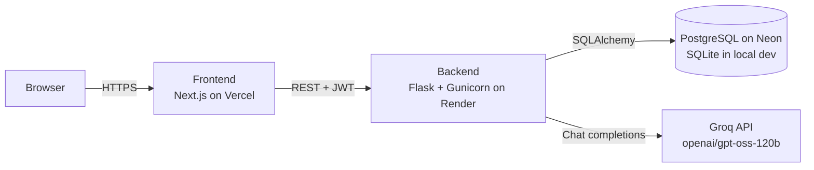

# IdeazBot

**An AI-powered ideation assistant.** Describe a project, a challenge or a need, and IdeazBot runs a structured creative session with you: it reframes the problem, analyses the context, generates and ranks ideas, then lets you keep the conversation going and turn any answer into an interactive mind map.

IdeazBot is a full-stack web application: a **Next.js** frontend, a **Flask** REST API, a **PostgreSQL / SQLite** database and an LLM served by **Groq**.

---

## Table of contents

- [Features](#features)
- [Architecture](#architecture)
- [Tech stack](#tech-stack)
- [Repository structure](#repository-structure)
- [Getting started (local development)](#getting-started-local-development)
- [Configuration](#configuration)
- [How the AI works](#how-the-ai-works)
- [Database](#database)
- [API reference](#api-reference)
- [Deployment](#deployment)
- [Security notes](#security-notes)
- [Troubleshooting](#troubleshooting)
- [Known limitations and ideas for improvement](#known-limitations-and-ideas-for-improvement)

---

## Features

**Conversational ideation**
- Replies adapted to the message. A greeting gets a short welcome, a vague request gets targeted follow-up questions, and a clear project gets a full ideation report.
- A structured ideation report: challenge reframing, context analysis (needs, trends, opportunities), five ideas, a ranked top 3 and a main concept. The model picks one or two ideation methods (SCAMPER, Six Thinking Hats, Crazy 8, analogy, etc.) to produce the ideas.
- Follow-up questions such as "develop idea 2" or "give me an action plan" get focused answers that build on the earlier conversation, without regenerating the whole report.
- Answers are rendered as Markdown, including readable, horizontally scrollable tables.

**Mind maps**
- A *Generate a mind map* button sits under every bot answer.
- The LLM condenses the answer into a short hierarchy of key ideas, so the map is not overloaded. Strict limits are applied on the server.
- The map is interactive (zoom, pan, collapse branches) and can be exported as a PNG image.
- If the AI summary fails, a local, simplified version is built instead.

**Accounts and history**
- Sign-up with first name, last name, email and password, plus JWT-based login. The greeting uses the user's first name.
- Every conversation is saved: users can reopen, search and delete their conversations and continue any of them.
- Conversations can be downloaded as a text file.

**User interface**
- Responsive layout for phones, tablets and desktops, with safe-area support for notched devices.
- Times are shown in the user's own time zone.

---

## Architecture



The frontend is mostly static pages that call the Flask API directly. Its address is set by `NEXT_PUBLIC_API_URL`. The backend is stateless: the conversation history is read from the database on every request, so it survives restarts and redeployments.

**What happens when a message is sent:**

1. The frontend sends `POST /api/chat` with the message, the current `conversationId` (if any) and the JWT.
2. The backend checks that the conversation belongs to the user, or creates a new one.
3. It loads the previous messages from the database and keeps the most recent ones, up to about 12,000 characters.
4. It calls Groq with a single system prompt plus this history.
5. **If generation succeeds**, the user message and the answer are stored together. If it fails, nothing is stored and a clear error is returned, so the user can simply resend.

---

## Tech stack

| Layer | Technologies |
|---|---|
| Frontend | Next.js 15 (App Router), React 19, TypeScript, Tailwind CSS 3, `react-markdown` + `remark-gfm`, `markmap-lib` / `markmap-view`, `lucide-react` |
| Backend | Python 3.12, Flask 2.3, Flask-SQLAlchemy 3, Flask-JWT-Extended 4, Flask-Cors, Gunicorn |
| AI | [Groq](https://groq.com) API. The default model is `openai/gpt-oss-120b`, configurable |
| Database | PostgreSQL (production, e.g. Neon) or SQLite (local development, zero setup) |
| Hosting | Vercel (frontend), Render (backend), Neon (database). All three offer free tiers |

---

## Repository structure

```
.
├── README.md
└── ideazBot-main/
    ├── Frontend/                         # Next.js application
    │   ├── app/
    │   │   ├── page.tsx                  # Landing page
    │   │   ├── Inscription/page.tsx      # Sign-up
    │   │   ├── Connexion/page.tsx        # Login
    │   │   ├── Chatbot/page.tsx          # Chat, history panel, Markdown rendering
    │   │   ├── Mindmap/page.tsx          # Mind map generation, display and PNG export
    │   │   ├── services/api.ts           # API base URL + auth helpers
    │   │   ├── types/index.ts            # Shared TypeScript types
    │   │   ├── layout.tsx                # Root layout, metadata, viewport
    │   │   └── globals.css
    │   ├── .env.example                  # Frontend environment variables
    │   ├── next.config.ts
    │   ├── tailwind.config.js
    │   └── package.json
    └── Projet_de_LLM/backend_flask/Backend/   # Flask API
        ├── app.py                        # Models, routes, prompts, LLM calls
        ├── requirements.txt
        ├── .python-version               # Python version used by the host (3.12)
        └── .env.example                  # Backend environment variables
```

The user interface and the routes are in French (`/Connexion` = login, `/Inscription` = sign-up).

---

## Getting started (local development)

### Prerequisites

- **Python 3.12**
- **Node.js 20+** and npm
- A free **Groq API key**: <https://console.groq.com/keys>

### 1. Backend (Flask API)

```bash
cd ideazBot-main/Projet_de_LLM/backend_flask/Backend

# Optional but recommended: a virtual environment
python -m venv venv
# Windows: venv\Scripts\activate     macOS/Linux: source venv/bin/activate

pip install -r requirements.txt

# Create your local configuration
cp .env.example .env        # Windows (PowerShell): Copy-Item .env.example .env
```

Edit `.env` and set at least `GROQ_API_KEY` and `JWT_SECRET_KEY`. You can generate a strong JWT key with:

```bash
python -c "import secrets; print(secrets.token_hex(32))"
```

Leave `DATABASE_URL` empty to use a local SQLite file (`instance/users.db`), created automatically. Then start the API:

```bash
python app.py
```

The API listens on <http://localhost:5000>. Check it with <http://localhost:5000/api/health>, which should return `{"status": "healthy"}`.

### 2. Frontend (Next.js)

```bash
cd ideazBot-main/Frontend
npm install
npm run dev
```

Open <http://localhost:3000>. By default the frontend talks to `http://localhost:5000`. To point it somewhere else, copy `.env.example` to `.env.local` and set `NEXT_PUBLIC_API_URL`.

### Useful scripts (frontend)

| Command | Description |
|---|---|
| `npm run dev` | Development server with hot reload |
| `npm run build` | Production build (type-checks the project) |
| `npm run start` | Serve the production build |

---

## Configuration

### Backend: `ideazBot-main/Projet_de_LLM/backend_flask/Backend/.env`

| Variable | Required | Default | Description |
|---|---|---|---|
| `GROQ_API_KEY` | **Yes** | – | Groq API key |
| `GROQ_MODEL` | No | `openai/gpt-oss-120b` | Groq model used for chat and mind maps |
| `JWT_SECRET_KEY` | **Yes in production** | development key | Secret used to sign login tokens, at least 32 bytes. The server refuses to start without it when `DATABASE_URL` is set |
| `DATABASE_URL` | No | `sqlite:///users.db` | Database URL. Use a PostgreSQL URL in production (`postgresql://…?sslmode=require`). `postgres://` URLs are converted automatically |
| `FRONTEND_URL` | No | `http://localhost:3000` | Origin(s) allowed by CORS, comma-separated, without a trailing slash |
| `EMAIL_USER`, `EMAIL_PASSWORD` | No | – | SMTP credentials for `/api/mindmap/send-email` (e.g. a Gmail *app password*) |
| `SMTP_SERVER`, `SMTP_PORT` | No | `smtp.gmail.com`, `587` | SMTP server |
| `PORT` | No | `5000` | Port for `python app.py`. In production, Gunicorn reads the host's `PORT` |

### Frontend: `ideazBot-main/Frontend/.env.local`

| Variable | Required | Default | Description |
|---|---|---|---|
| `NEXT_PUBLIC_API_URL` | No | `http://localhost:5000` | Base URL of the Flask API. It is **inlined at build time**, so redeploy after changing it |

> Never commit `.env` files. They are already excluded by `.gitignore`, and only the `.env.example` templates are versioned.

---

## How the AI works

### One system prompt, several kinds of answer

Every request sends a single system prompt plus the recent conversation history to the model. The prompt tells the model to classify the **latest** user message and answer accordingly:

| Situation | Behaviour |
|---|---|
| Greeting, thanks, question about the bot | Short, friendly reply. No ideas are generated |
| Request too vague to work on | Two to four targeted questions (topic, audience, goal, constraints) |
| Clear project or challenge | Full ideation report (format below) |
| Follow-up on earlier answers | Focused answer that builds on the conversation |
| Off-topic message | Brief answer, then a nudge back to the project |

The prompt also sets quality rules. The model must stay faithful to the user's topic, must not invent statistics or company names, must keep the top 3 consistent with the ideas it generated, must answer in the user's language, and must use simple Markdown, with tables only when they help.

### Ideation report format

1. **Methods used**: one or two ideation techniques chosen for the challenge.
2. **🎯 Challenge reframing**
3. **🔍 Context analysis**: needs, trends, opportunities.
4. **💡 Idea generation**: five ideas, each with how it works, its added value and a concrete example.
5. **⭐ Top 3 recommendations**, with justification.
6. **🚀 Main concept**: name, description, key benefits.

### Context window

The history sent to the model is trimmed from the oldest messages until it fits in about **12,000 characters** (`MAX_HISTORY_CHARS`). This keeps requests within the provider's token limits.

### Mind map generation

`POST /api/mindmap/generate` sends a single answer to the model with a dedicated prompt: keep only the key ideas, use short labels of a few keywords, and put idea names rather than explanations. The output is then **normalised on the server**, so the map stays readable whatever the model returns:

- one root, at most **6** branches and **4** leaves per branch;
- labels of at most **7** words. For "Name – explanation" labels, only the name is kept.

The frontend renders the result with Markmap and caches it in the browser. If the call fails, a simplified local version is built from the answer's headings and list items.

---

## Database

Three tables, managed with SQLAlchemy:

```
user (1) ──< conversation (N) ──< message (N)
```

| Table | Columns | Notes |
|---|---|---|
| `user` | `id`, `email` (unique), `password`, `prenom`, `nom` | Passwords are hashed with Werkzeug (scrypt) and never stored in clear text |
| `conversation` | `id`, `user_id`, `title`, `preview`, `created_at` | The title comes from the first message, the preview from the latest answer |
| `message` | `id`, `conversation_id`, `content`, `is_bot`, `created_at` | `content` is raw Markdown |

- **Cascades:** deleting a user deletes their conversations, and deleting a conversation deletes its messages.
- **Time zones:** dates are returned to the frontend in ISO 8601 UTC and displayed in the browser's time zone.
- **Schema creation:** tables are created automatically on startup (`db.create_all()`). Since `create_all()` does not alter existing tables, newly added `user` columns are added by a small startup routine (`add_missing_user_columns`). For larger schema changes, a migration tool such as Flask-Migrate is recommended.

---

## API reference

All protected routes expect an `Authorization: Bearer <token>` header. Tokens are valid for **24 hours**.

| Method | Route | Auth | Description |
|---|---|---|---|
| `GET` | `/` | – | API info |
| `GET` | `/api/health` | – | Health check, returns `{"status": "healthy"}` |
| `POST` | `/api/auth/signup` | – | Create an account. Body: `{email, password, prenom, nom}` |
| `POST` | `/api/auth/login` | – | Log in. Returns `{token, user}` |
| `GET` | `/api/user/profile` | ✔ | Current user (`id`, `email`, `prenom`, `nom`) |
| `GET` | `/api/conversations` | ✔ | The user's conversations, newest first |
| `GET` | `/api/conversations/<id>` | ✔ | Messages of a conversation, in order |
| `DELETE` | `/api/conversations/<id>` | ✔ | Delete a conversation and its messages |
| `POST` | `/api/chat` | ✔ | Send a message. Body: `{message, conversationId?}`. Returns `{message, conversationId}` |
| `POST` | `/api/chat/start` | ✔ | Create a conversation with a welcome message |
| `POST` | `/api/mindmap/generate` | ✔ | Condense an answer into a mind map. Body: `{content}`. Returns `{markdown}` |
| `POST` | `/api/mindmap/export` | ✔ | Export Markdown content as `markdown` or styled `html` |
| `POST` | `/api/mindmap/send-email` | ✔ | Email some content, or the latest answer of a conversation. Requires SMTP configuration |

Users can only read or modify their own conversations: every query is filtered by the authenticated user ID.

**Example**

```bash
TOKEN=$(curl -s -X POST http://localhost:5000/api/auth/login \
  -H "Content-Type: application/json" \
  -d '{"email":"jane@example.com","password":"secret"}' | python -c "import sys, json; print(json.load(sys.stdin)['token'])")

curl -X POST http://localhost:5000/api/chat \
  -H "Authorization: Bearer $TOKEN" -H "Content-Type: application/json" \
  -d '{"message":"I want to launch an app that reduces food waste in student residences"}'
```

---

## Deployment

The production setup uses three free services. Deploy them in this order:

### 1. Database: Neon (PostgreSQL)

1. Create a project at <https://neon.tech>, ideally in the same region as the backend.
2. Click **Connect**, enable **connection pooling** and copy the connection string (`postgresql://…?sslmode=require`).
3. You don't need to create any tables: the backend creates them on its first start.

### 2. Backend: Render

Create a **Web Service** from the GitHub repository:

| Setting | Value |
|---|---|
| Root Directory | `ideazBot-main/Projet_de_LLM/backend_flask/Backend` |
| Build Command | `pip install -r requirements.txt` |
| Start Command | `gunicorn app:app --timeout 120` |
| Health Check Path | `/api/health` |
| Environment | `PYTHON_VERSION=3.12.1`, `GROQ_API_KEY`, `GROQ_MODEL`, `JWT_SECRET_KEY` (a production-only key), `DATABASE_URL`, `FRONTEND_URL` |

### 3. Frontend: Vercel

Import the repository with these settings:

| Setting | Value |
|---|---|
| Root Directory | `ideazBot-main/Frontend` |
| Framework Preset | Next.js |
| Environment | `NEXT_PUBLIC_API_URL=https://<your-backend>.onrender.com` |

### 4. Connect the two

Set `FRONTEND_URL` on Render to the production Vercel URL, for example `https://<project>.vercel.app` (no trailing slash), then redeploy. Otherwise the browser blocks API calls (CORS).

Both Render and Vercel redeploy automatically on every push to `main`.

> **Free-tier notes:** a Render free service sleeps after about 15 minutes of inactivity, so the first request afterwards takes 30 to 50 seconds. A Neon free database pauses after a few idle minutes and wakes up in about a second. The backend handles this with `pool_pre_ping`.

---

## Security notes

- **Secrets:** keep them only in `.env` files (local) and in the host's environment settings (production). Never commit them, and never paste them in issues or chats. If a secret leaks, rotate it: reset the Neon role password, regenerate the Groq key, change `JWT_SECRET_KEY`.
- **JWT key:** use a different, random key of at least 32 bytes in production. Changing it logs every user out.
- **Passwords** are hashed (scrypt). Tokens are stored in the browser's `localStorage` and expire after 24 hours.
- **CORS** is restricted to the origins listed in `FRONTEND_URL`.
- **LLM cost and abuse:** anyone who signs up uses your Groq quota. Before a public launch, consider adding rate limiting, for example with Flask-Limiter.

---

## Troubleshooting

| Symptom | Likely cause and fix |
|---|---|
| Every answer fails with "model not available" | The Groq model was retired. Set another available model in `GROQ_MODEL` |
| `401` / `422` on protected routes after a change | The token was signed with an old `JWT_SECRET_KEY`. Log out and log in again |
| `blocked by CORS policy` in the browser console | `FRONTEND_URL` doesn't exactly match the site's origin (check `https`, the trailing slash, preview vs production URL) |
| Frontend calls `localhost:5000` in production | `NEXT_PUBLIC_API_URL` was missing at build time. Set it and redeploy |
| Backend won't start: `JWT_SECRET_KEY doit être défini en production` | `DATABASE_URL` is set but `JWT_SECRET_KEY` isn't. Add it |
| `psycopg2.OperationalError` | Wrong or incomplete `DATABASE_URL`. Copy it again from the database provider |
| Very slow first response in production | The free Render instance was asleep. This is expected |

---

## Known limitations and ideas for improvement

- **No migration framework:** only the `prenom` / `nom` columns are added automatically. Adopting Flask-Migrate would make future schema changes safer.
- **File attachments are not processed:** the paperclip button lets users pick files, but their content isn't sent to the model.
- **Linting:** the ESLint configuration (`eslint-config-next` 14 with ESLint 8) doesn't match Next.js 15, so the lint step is skipped during builds. Upgrading ESLint would re-enable it.
- **Possible next steps:** response streaming, rate limiting, password reset ("Forgot password?" is not implemented yet), profile editing, and automated tests for the API.
